 

 

## About

Logistics and Transport student. I use programming to analyze and improve processes related to supply chains, routes and transport operations.

 

## Tech stack

<code>$ cat stack.md</code>  (click to expand)

 

| Area | Technologies |
|---|---|
| Programming | Python, JavaScript, R |
| Web | HTML, CSS |
| Servers | Ubuntu, Linux, Bash |
| Minecraft | Mod development (Java) |
| Tools | Git, GitHub |

 

## Future projects

<code>$ cat future_projects.txt</code>  (click to expand)

 

Project ideas related to my field of study:

- **Route optimization models** - vehicle routing and shortest-path problems (Python)
- **Supply chain analytics** - demand analysis and statistical reporting (R)
- **Inventory forecasting** - stock levels and demand prediction (Python, R)
- **Transport KPI dashboard** - delivery time, cost and fleet metrics (JavaScript, HTML, CSS)
- **Warehouse layout simulator** - picking paths and storage allocation (Python)

 

## Connect

